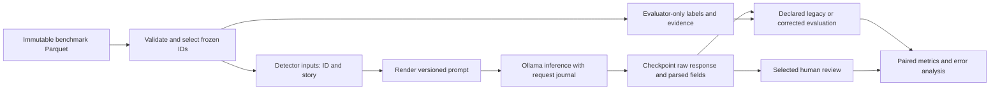
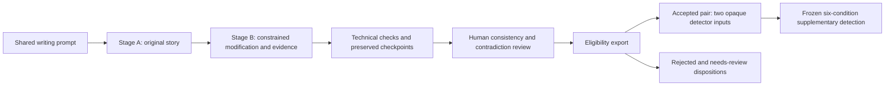

# Narrative Inconsistency Detection Using Large Language Models

An NTU Computer Science Final Year Project investigating how locally hosted language models detect, explain and construct inconsistencies in fictional stories, using FLAWEDFICTIONS as the primary benchmark.

## Contents

- [Project overview](#project-overview)
- [Research objectives](#research-objectives)
- [Key features](#key-features)
- [System architecture](#system-architecture)
- [Repository structure](#repository-structure)
- [Models and prompting strategies](#models-and-prompting-strategies)
- [Datasets](#datasets)
- [Experimental design and status](#experimental-design-and-status)
- [Evaluation metrics](#evaluation-metrics)
- [Results and findings](#results-and-findings)
- [Cross-experiment insights](#cross-experiment-insights)
- [Installation and requirements](#installation-and-requirements)
- [Usage guide](#usage-guide)
- [Reproducibility](#reproducibility)
- [Limitations](#limitations)
- [Future work](#future-work)
- [References and acknowledgements](#references-and-acknowledgements)

## Project overview

A narrative contradiction occurs when two claims about the same story world cannot both hold under the relevant circumstances. A continuity error violates an established fact about a character, event, object or world rule. “Plot hole” is a broader literary term; this project operationalises the task through continuity-error labels and supporting passages rather than judging every omission or implausible event as a flaw.

The difficulty lies in tracking entities and events across a story while distinguishing genuine incompatibility from ordinary change, flashbacks, metaphor, character beliefs and an explicit resolution. LLMs can read and produce extended narratives, but a plausible explanation does not necessarily demonstrate that these distinctions were made correctly.

The project combines local benchmark inference, controlled prompt comparisons, an audit of automatic evaluation, selected human review, and a separate synthetic story-pair experiment. It studies **classification, reference-evidence localisation and human explanation support as distinct outcomes**. The completed main study compares three models on the same 100 stories; it is not a full reproduction of every experiment in the original benchmark paper.

This README reflects the saved evidence reviewed on 18 October 2026.

## Research objectives

1. Establish a reproducible Ollama pipeline for the released FLAWEDFICTIONS detection and localisation task, initially targeting Qwen3 4B and 8B.
2. Compare Qwen3 8B, Llama 3.1 8B and Mistral 7B, and investigate whether procedural prompting improves decisions and evidence selection.
3. Separate genuine model improvements from parser defaults, evidence-matching defects and changes in class bias.
4. Examine selected explanations in their full narrative context to identify supported reasoning and recurring errors.
5. Test whether the same model families can construct controlled original/modified story pairs, validate those pairs, and apply the frozen detectors to the material that passes review.

These objectives are addressed at different scales: pilots support development, Main100 supports the principal paired comparison, and the generated-story detector study supplies one diagnostic contrastive case.

## Key features

- Local inference through a shared Ollama client, with model-specific configuration and explicit Qwen thinking control.
- Versioned baseline and experimental prompts, frozen sample manifests, input/template hashes and model identity checks.
- Structured prediction records preserving raw responses, parsed fields, warnings, timing, token metadata and errors.
- Bounded technical retries, durable request journals, atomic checkpoints and compatible resume in the later experiment runners.
- Separate legacy and corrected evaluation, per-record traces, confusion counts, paired comparisons and exploratory uncertainty analysis.
- Human-review packets that preserve existing annotations, plus generated-pair eligibility validation and gold-free detector exports.
- Offline tests for loaders, parsers, scoring, retries, interruption recovery, experiment orchestration and export invariants in [tests](tests).

## System architecture

The [dataset layer](src/fyp/data), [prompting layer](src/fyp/prompting), [model client](src/fyp/models) and [evaluation layer](src/fyp/evaluation) are coordinated by experiment-specific runners under [src/fyp/experiments](src/fyp/experiments).



Gold annotations are joined for evaluation, not inserted into detector prompts. Later runners validate frozen inputs, prompts, model identity and runtime before dispatch. A received journal response can be recovered without another model call, completed compatible records and exhausted failures are retained across resume.



Generation recovery uses separately versioned namespaces and reuses available successful stages. Technical warnings do not authorise silently editing a response or retrying merely for a better story.

## Repository structure

```text
.
├── README.md
├── pyproject.toml                     # Python package and dependencies
├── configs/
│   ├── models/                       # Ordinary, Main10/Main100 and generation settings
│   ├── experiments/                  # Versioned study and scoring configurations
│   └── analysis/                     # Exploratory statistical settings
├── data/
│   ├── raw/flawed-fictions/           # Immutable official Parquet files
│   ├── pilot/                        # Fixed development manifests
│   ├── final/                        # Earlier large-scope Qwen manifests
│   └── generated_stories_verified_v1/ # Accepted detector inputs and evaluator-only provenance
├── prompts/                          # benchmark/, experimental/, frozen/, generation/
├── src/fyp/
│   ├── cli.py                        # General dataset, model and run commands
│   ├── data/                         # Loading, normalisation, validation and manifests
│   ├── models/                       # Configuration, Ollama transport and journaling
│   ├── prompting/                    # Templates, parsing and prediction records
│   ├── evaluation/                   # Legacy and corrected localisation/classification
│   └── experiments/                  # Study runners, recovery, review and aggregation
├── experiments/
│   ├── runs/                         # Mixed20 and historical Qwen runs
│   ├── summaries/                    # Pilot analyses
│   ├── three_model_main10/           # Three-model development baselines
│   ├── three_model_main10_prompting/ # Development prompt comparisons
│   ├── main100_comparison_v1/        # Frozen sample and preparation lineage
│   ├── main100_comparison_v2_ollama0400/ # Executed main study and analysis/human_review_v1/
│   ├── generated_stories_v1/         # Original construction workflow
│   └── generated_stories_detection_v1/ # Supplementary detector checkpoints and analysis
├── scripts/                          # Audits and analysis adapters
├── tests/                            # Offline regression tests
└── external/flawedfictions/           # Preserved upstream reference implementation
```

The tree highlights entry points rather than every artifact. Additional `generated_stories_recovery_*`, `generated_stories_diagnostics_*` and `generated_stories_schema_recovery_v1` directories preserve recovery history. Use the [scoring comparison](experiments/main100_comparison_v2_ollama0400/analysis/scoring_correction_v1/comparison.csv) when tracing a result.

## Models and prompting strategies

| Ollama identifier | Completed role |
| --- | --- |
| `qwen3:4b` | Initial Mixed20 baseline, prompting and native-thinking pilot, partial later historical runs |
| `qwen3:8b` | Mixed20, Main10, Main100, synthetic generation and supplementary detection |
| `llama3.1:8b` | Main10, Main100, synthetic generation and supplementary detection |
| `mistral:7b` | Main10, Main100, synthetic generation and supplementary detection |

Qwen3 4B/8B remain the repository's original primary targets. The final comparative study uses Qwen3 **8B** as its primary model and Llama/Mistral as comparisons. Main100 records Q4_K_M model artifacts, exact digests and native templates are retained in its [model inspection](experiments/main100_comparison_v2_ollama0400/model_inspection.json).

| Strategy | Implemented procedure | Completed evidence |
| --- | --- | --- |
| [Vanilla](prompts/benchmark/vanilla_v1.txt) | Released direct detection prompt requesting explanation, evidence passages and a final decision | Mixed20, Main10, Main100 |
| [Evidence-first v2](prompts/experimental/evidence_first_v2.txt) | Privately locate conflicting passages, check surrounding context, retain supported unresolved pairs | Main10; Mixed20 used [v1](prompts/experimental/evidence_first_v1.txt) |
| [Structured-check v1](prompts/experimental/structured_check_v1.txt) | Privately check identities/relationships, time, location/possession, world rules and contextual resolution | Main10 only |
| [Verify-and-revise v2](prompts/experimental/verify_revise_v2.txt) | Privately form a tentative decision, check false positives and missed conflicts, then return the final answer | Main10, Main100 and supplementary detection; Mixed20 used [v1](prompts/experimental/verify_revise_v1.txt) |

All these detection conditions use **one inference call per attempt**. Verify-and-revise is an instruction inside that call, not an observable draft–verifier–revision pipeline. The final response uses XML-like `explanation`, `error_lines`, `contradicted_lines` and `decision` fields. Native Qwen thinking is disabled except in explicitly labelled Mixed20 ablations; other models omit the unsupported thinking option.

Released [CoT](prompts/benchmark/cot_v1.txt) and [few-shot](prompts/benchmark/fewshot_v1.txt) assets are also implemented in the [prompt registry](src/fyp/prompting/strategies.py), but are not completed Main100 conditions. The generic CLI's `evidence_first` and `verify_revise` names select **v1**; the experiment-specific Main10/Main100 adapters select the frozen v2 prompts. They are not interchangeable reproduction commands.

## Datasets

### FLAWEDFICTIONS

The [official benchmark](https://huggingface.co/datasets/kahuja/flawed-fictions) pairs fictional narratives with binary continuity-error labels and reference explanations/evidence. Local Parquet files are preserved under [data/raw/flawed-fictions](data/raw/flawed-fictions). The recorded fields are `example_id`, `story`, `cont_error`, `cont_error_expl`, `cont_error_lines` and `contradicted_lines`. Label 1 means an inconsistency; label 0 means no annotated continuity error.

| Released subset | Stories | Positive | Negative |
| --- | ---: | ---: | ---: |
| `flawed_fictions` | 414 | 207 | 207 |
| `flawed_fictions_long` | 200 | 97 | 103 |
| `flawed_fictions_error_resolved_negs` | 414 | 207 | 207 |
| `flawed_fictions_cf_negs` | 414 | 207 | 207 |
| **Total released rows** | **1,442** | **718** | **724** |

These are related collections, including alternative negative versions, not 1,442 independent source narratives. The [loader](src/fyp/data/loader.py) normalises labels and annotation fields in memory while preserving original story text and raw records. Validation checks schema, counts, labels, IDs and required positive evidence. It does not rewrite raw Parquet files.

Mixed20 contains ten main and ten long stories, each stratum balanced 5/5. Main10 reuses the ten main stories from that pilot. Main100 samples only the main subset: 204 rows were excluded through the documented exposure/family audit, leaving 210 eligible rows; deterministic salted-hash ranking selected 50 positive and 50 negative stories. The selected stories form 96 **inferred** source families, with no pilot-ID overlap. This is audited eligibility, not proof of absence of all prior exposure or pretraining contamination.

[Detector inputs](experiments/main100_comparison_v1/detector_inputs.jsonl) contain only story IDs and text; [evaluator-only metadata](experiments/main100_comparison_v1/evaluator_only/manifest.json) holds labels and provenance. The recorded Hugging Face dataset revision is `733717281afdb715538b753f0f85ef7d55568b85`. Preserve upstream notices and conditions when redistributing benchmark resources; this README does not assign a new license to the project.

### Synthetic narrative pairs

The separate [generation experiment](experiments/generated_stories_v1) schedules ten shared writing prompts for each of three generators: **30 candidate pairs**. Stage A requests an internally consistent original of 400–700 words; Stage B requests a limited modification introducing one contradiction, plus evidence and an explanation. Word targets and edit-size warnings are checks, not guarantees of semantic validity.

The [editing instructions](experiments/generated_stories_v1/editing_instructions.json) cover character facts/relationships, timeline/event order, location/movement, object possession/properties and explicit fictional-world rules. Prompts are versioned under [prompts/generation](prompts/generation), separately from detector prompts.

Technical completion required original, recovery, diagnostic and schema-constrained stages. Human review asks whether the original is consistent, the modification contains one clear intended contradiction, and the evidence/explanation are correct. Uncertainty takes precedence in eligibility; unresolved judgments are not silently converted into acceptance.

The completed human review and [verified export](data/generated_stories_verified_v1/evaluator_only/summary.json) yield **1 accepted, 22 rejected and 7 needs-review pairs**. Only the accepted Llama-generated fictional-world pair contributes its two texts to [detector_inputs.jsonl](data/generated_stories_verified_v1/detector_inputs.jsonl). Pair membership, generator identity, gold and review provenance remain evaluator-side. The 30 technically available candidates must not be described as a 30-pair verified benchmark.

## Experimental design and status

| Study | Scope and status | Evidence location |
| --- | --- | --- |
| Mixed20 feasibility | Complete: 2 Qwen sizes × 4 conditions × 20 stories = 160 final records, including failures; legacy scoring | [saved summaries](experiments/summaries) |
| Main10 prompt development | Complete: 3 models × 4 strategies × 10 stories = 120 records; legacy scoring; baseline outputs reused for paired comparisons | [Baselines](experiments/three_model_main10), [prompting](experiments/three_model_main10_prompting) |
| Main100 preparation v1 | Frozen selection/contracts; superseded as execution namespace by runtime revision v2 | [Preparation](experiments/main100_comparison_v1) |
| Main100 v2 | Authoritative main comparison: 3 models × 2 prompts × 100 stories = 600 records; Ollama 0.40.0 | [Execution root](experiments/main100_comparison_v2_ollama0400) |
| Scoring audit | Completed offline on the same 600 responses; corrected_v1 is primary for final Main100 results | [Correction traces and analysis](experiments/main100_comparison_v2_ollama0400/analysis/scoring_correction_v1) |
| Benchmark human review | Complete: 30 selected model–story pairs, 29 distinct stories, 60 judgments | [Authoritative simplified review](experiments/main100_comparison_v2_ollama0400/analysis/human_review_v1/manual_review_simple.csv) |
| Synthetic construction | 30 technically complete pairs cumulatively; 1 accepted, 22 rejected, 7 unresolved in current review | [Original generation](experiments/generated_stories_v1), [eligibility outcomes](data/generated_stories_verified_v1/evaluator_only/summary.json) |
| Supplementary detection | Complete: 6 conditions × 2 texts = 12 final outputs, one accepted pair; Ollama 0.40.3 | [Detection experiment](experiments/generated_stories_detection_v1) |
| Earlier large Qwen plan | **Partial:** 121 of 2,376 scheduled records; one run has 107, seven have 2 each; not a completed comparison | [Saved historical runs](experiments/runs) |
| Early 85-record baseline | Historical and unverified: original raw run unavailable | Raw evidence unavailable |

Main100 selected verify-and-revise using a frozen Main10 rule: rank experimental candidates by Qwen CEEval-Full, then CEEval-Pos and operational tie-breakers. It did **not** select the highest-accuracy candidate. No candidate exceeded the Qwen vanilla Full score in development. This is prompt selection on development data, followed by a separate shared evaluation sample.

Generation namespaces also encode history: original execution produced 11 technically complete pairs, recovery v2 brought the cumulative total to 20, and diagnostic/schema recovery brought it to 30. Earlier runtime-blocked preparations and failed stages are retained, not counted as extra independent successes.

## Evaluation metrics

The positive class is **continuity error present**. Primary Main100 and supplementary results use [corrected_v1](src/fyp/evaluation/corrected_v1.py) with its [versioned policy](configs/experiments/main100_scoring_correction_v1.json). Mixed20/Main10 retain their historical released-style [parser](src/fyp/prompting/parser.py) and [evaluator](src/fyp/evaluation/evaluator.py); their scores should not be pooled with corrected results.

Let `N` be all scheduled final records, `P` all gold positives, and `I+` invalid predictions on gold positives. TP/FP/TN/FN below count valid binary predictions.

| Metric | Primary definition |
| --- | --- |
| Accuracy | `(TP + TN) / N`; invalids and terminal failures remain incorrect |
| Precision | `TP / (TP + FP)` |
| Recall | `TP / P`; invalid positive cases remain in the denominator |
| F1 | `2TP / (2TP + FP + FN + I+)` |
| Specificity | `TN / (N - P)` |
| CEEval-Full | `(correct negatives + correctly detected positives matching both reference evidence sides) / N` |
| CEEval-Pos | `correctly detected positives matching both reference evidence sides / P` |
| Terminal failure rate | Terminal inference failures / all scheduled final records |
| Human explanation support | Separate Yes/No/Unsure judgments on selected explanations; no benchmark-wide rate inferred |

Undefined divisions return zero. Confusion counts retain invalid-positive and invalid-negative bins separately rather than forcing invalid responses into a class. Under corrected_v1, a unique recognised explicit decision is required. Malformed outer wrappers or evidence fields may produce warnings without invalidating an otherwise valid decision. A parser warning is therefore not synonymous with a failed inference or an invalid prediction.

Localisation expands normalised snippets to story sentences and requires non-strict overlap on **both corresponding sides** of the reference contradiction, conditional on a correct positive decision. Correct negatives receive Full credit without a positive evidence requirement. The correction rejects empty-normalised evidence fragments and bounds malformed evidence fields so that they cannot absorb later response fields. Legacy and corrected results are preserved side by side; raw responses were not rewritten.

**CEEval measures reference localisation, not semantic correctness of the explanation prose.** Non-strict overlap can tolerate additional incorrect quotations. Correct negatives also influence Full strongly: an all-negative classifier obtains 50% accuracy and 50% Full on balanced Main100, with zero Pos. The separate human review addresses support for the explanation but uses a diagnostic selection, not a representative random sample.

Final exploratory uncertainty analysis uses 20,000 paired family-cluster bootstrap draws (seed 20261015), exact family-block paired tests and Holm adjustment across nine model/endpoint tests. See the [statistical configuration](configs/analysis/phase2_quantitative_v1.json). This retrospective analysis is conditional on the selected sample and inferred families, not a preregistered causal study.

## Results and findings

### Main100: corrected results

Each row contains the same 100 stories: 50 positive and 50 negative. All scores are percentages. Baseline is `vanilla_v1`; verify is `verify_revise_v2`. Qwen and Llama are 8B, Mistral is 7B.

| Model | Prompt | Accuracy | Precision | Recall | F1 | CEEval-Full | CEEval-Pos |
| --- | --- | ---: | ---: | ---: | ---: | ---: | ---: |
| Qwen3 | Baseline | 48.00 | 25.00 | 2.00 | 3.70 | 47.00 | 0.00 |
| Qwen3 | Verify | 57.00 | 56.14 | 64.00 | 59.81 | 30.00 | 10.00 |
| Llama 3.1 | Baseline | 49.00 | 50.52 | 98.00 | 66.67 | 6.00 | 12.00 |
| Llama 3.1 | Verify | 50.00 | 50.00 | 60.00 | 54.55 | 22.00 | 4.00 |
| Mistral | Baseline | 42.00 | 34.62 | 18.00 | 23.68 | 33.00 | 0.00 |
| Mistral | Verify | 49.00 | 49.48 | 96.00 | 65.31 | 3.00 | 4.00 |

Source: [record-level correction traces](experiments/main100_comparison_v2_ollama0400/analysis/scoring_correction_v1/record_traces.jsonl). All six conditions have zero terminal inference failures. Llama baseline has three invalid explicit decisions (one positive, two negative); these remain in its 100-record denominator.

Qwen verify has the highest observed accuracy, but the +9-point gain comprises **32 corrections and 23 regressions**. Llama has 21 corrections/20 regressions (+1 point), and Mistral 39/32 (+7). None of the accuracy gains is established under the adjusted exploratory paired tests. The prompts substantially change decision bias: Qwen baseline misses 49 of 50 positives; Mistral verify raises recall to 96% while misclassifying 49 of 50 negatives.

Localisation gives a different picture. Qwen's Pos rises from 0% to 10%, while Full falls from 47% to 30% as correct-negative credit declines. Llama's Full rises from 6% to 22%, while Pos falls from 12% to 4%. No single strategy improves all outcomes across all models.

The scorer audit also matters. On unchanged Llama baseline responses, legacy accuracy/Full/Pos were 51%/13%/24%; corrected results are 49%/6%/12%. These changes are measurement corrections, not new model performance. The [scoring comparison](experiments/main100_comparison_v2_ollama0400/analysis/scoring_correction_v1/comparison.csv) preserves all six comparisons.

### Development findings

Mixed20 showed low positive localisation and strong negative bias. Qwen 4B baseline accuracy was 45%, versus 55% with evidence-first v1, but Pos declined from 10% to 0%. Qwen 8B baseline and verify-revise v1 both scored 50% by predicting every story negative. Qwen 8B native thinking retained six terminal failures; Qwen 4B verify-revise retained two. These are operational findings under the recorded limits, not proof that thinking inherently harms reasoning.

On Main10, Qwen evidence-first v2 reached 70% accuracy but 0% Pos; verify-revise reached 60% accuracy, 30% Full and 20% Pos. The baseline had 50% Full through all-negative predictions. Llama's four prompts all scored 50% accuracy despite different decisions; Mistral's three experimental prompts predicted every story positive. See the saved [Mixed20 summaries](experiments/summaries) and [Main10 prompt comparisons](experiments/three_model_main10_prompting). Main10 improvements are development observations with coarse ten-story denominators.

### Human review and reasoning failures

The completed review contains ten selected cases per model, with baseline and verify explanations assessed for each case.

| Model | Baseline Yes / No / Unsure | Verify Yes / No / Unsure |
| --- | --- | --- |
| Qwen3 8B | 3 / 4 / 3 | 0 / 10 / 0 |
| Llama 3.1 8B | 0 / 9 / 1 | 3 / 7 / 0 |
| Mistral 7B | 2 / 5 / 3 | 0 / 9 / 1 |

These are counts in a **selected diagnostic packet**, not population explanation-quality estimates. The [source judgments](experiments/main100_comparison_v2_ollama0400/analysis/human_review_v1/manual_review_simple.csv) are authoritative; the earlier blank detailed form is not the completed review.

Qualitative analysis identifies invented premises, literalised comparisons, ordinary changes treated as contradictions, beliefs treated as world facts, compatible properties treated as exclusive, and explanations that rationalise a real conflict instead of detecting it. Supported Llama cases also show successful contextual reconciliation. In Qwen's `flawed_fictions_241`, automatic both-side reference credit coexists with a human No judgment, illustrating that quoting matching passages does not ensure a sound explanation.

### Synthetic construction and supplementary detection

| Generator | Scheduled pairs | Technically complete after recovery | Accepted | Rejected | Needs review |
| --- | ---: | ---: | ---: | ---: | ---: |
| Qwen3 8B | 10 | 10 | 0 | 9 | 1 |
| Llama 3.1 8B | 10 | 10 | 1 | 6 | 3 |
| Mistral 7B | 10 | 10 | 0 | 7 | 3 |
| **Total** | **30** | **30** | **1** | **22** | **7** |

Source: [eligibility counts](data/generated_stories_verified_v1/evaluator_only/summary.json). Technical completion improved from 11 to 20 to 30 cumulative pairs, but accepted yield is only **1/30 (3.33%)** under the current review. Failures include unresolved original inconsistencies, changes that remove rather than introduce a conflict, invalid quoted evidence, and proposed contradictions that are actually compatible statements. Recovery success is not semantic validation.

The supplementary detector experiment used only the accepted pair, with two texts per condition:

| Model | Prompt | Texts classified correctly | Complete pair correct | Positive reference localisation |
| --- | --- | ---: | ---: | ---: |
| Qwen3 8B | Baseline | 2/2 | 1/1 | 1/1 |
| Qwen3 8B | Verify | 2/2 | 1/1 | 1/1 |
| Llama 3.1 8B | Baseline | 1/2 | 0/1 | 0/1 |
| Llama 3.1 8B | Verify | 1/2 | 0/1 | 0/1 |
| Mistral 7B | Baseline | 1/2 | 0/1 | 0/1 |
| Mistral 7B | Verify | 1/2 | 0/1 | 0/1 |

Source: [supplementary metrics](experiments/generated_stories_detection_v1/analysis/metrics.json). All 12 outputs completed without terminal failures or invalid decisions. This is one contrastive case under Ollama 0.40.3, not twelve independent narratives or evidence of general model superiority.

## Cross-experiment insights

The studies expose three distinct requirements: recognise a conflict, locate its evidence, and explain why the claims cannot jointly hold. Correct classification does not imply a supported explanation, and overlapping reference passages do not guarantee a correct argument. Human review adds information that the automatic scorer was not designed to measure.

Procedural prompting changes the balance between missed errors and false alarms, but does not consistently improve reasoning. Main100 shows model-dependent recall/specificity shifts; selected explanations show both useful contextual reconciliation and unsupported rationalisation. Because verify-and-revise hides the tentative answer, the saved outputs cannot establish that a particular internal revision occurred or that verification causally reinforced an earlier mistake.

Generation provides a complementary test of whether models can specify a real contradiction while preserving the rest of a narrative. Its low accepted yield shows why valid JSON, complete fields and exact quotes are insufficient for semantic acceptance. The accepted pair then makes a controlled detector contrast possible, but its selection and single-family scope prevent generalisation to generated narratives as a whole.

## Installation and requirements

Run commands in **PowerShell from the repository root**. The package requires Python **3.12 or newer**; the recorded development environment is Python 3.12.10. Runtime dependencies are `nltk>=3.6` and `pyarrow>=15`; `pytest>=8` is the development extra in [pyproject.toml](pyproject.toml). The frozen Main100 preparation records NLTK 3.10.3 and PyArrow 25.0.1; installing the broad dependency ranges alone does not reproduce those exact versions.

Use the existing `.venv` when working in the research checkout. For a fresh clone without an environment, create it once:

```powershell
py -3.12 -m venv .venv
```

Install into that environment and check the CLI:

```powershell
.\.venv\Scripts\python.exe -m pip install -e ".[dev]"
.\.venv\Scripts\python.exe -m fyp.cli --help
```

Sentence localisation uses NLTK English tokenisation. A fresh environment can obtain the resources using:

```powershell
.\.venv\Scripts\python.exe -m nltk.downloader punkt punkt_tab
```

This downloads tokenizer data. A deterministic regex fallback exists when NLTK data is unavailable, but it is not exact tokenizer parity. Historical reproduction should verify the tokenizer resources against the saved preparation hashes.

Install and start Ollama separately using its [Windows instructions](https://docs.ollama.com/windows). The Python client defaults to `http://localhost:11434`; it does not require an API key or a repository `.env` file. Download only missing models needed for the intended study:

```powershell
ollama pull qwen3:4b
ollama pull qwen3:8b
ollama pull llama3.1:8b
ollama pull mistral:7b
```

Pulling a tag downloads the currently available artifact; it does not guarantee the historical digest. Main100 pins Ollama **0.40.0**, while supplementary detection records **0.40.3**. Historical model/runtime guards must pass before a frozen run can resume; do not change a contract merely to bypass a mismatch.

Place the four official dataset subsets in `data/raw/flawed-fictions/` as `flawed_fictions.parquet`, `flawed_fictions_long.parquet`, `flawed_fictions_error_resolved_negs.parquet` and `flawed_fictions_cf_negs.parquet`. Obtain missing subsets from the [official dataset](https://huggingface.co/datasets/kahuja/flawed-fictions); preserve the recorded revision for historical reproduction. `prepare` validates local files; it does not download data.

```powershell
.\.venv\Scripts\python.exe -m fyp.cli prepare
.\.venv\Scripts\python.exe -m fyp.cli doctor
```

`prepare` reads and validates all 1,442 rows in memory without producing processed files. `doctor` checks the environment, data, Ollama and original Qwen targets without submitting benchmark prompts. No minimum hardware specification is established. Preparation records describe a laptop with approximately 15.73 GiB RAM and an RTX 3050 Laptop GPU with 6 GiB VRAM, not a complete per-run memory/offload profile or a recommended minimum.

## Usage guide

The commands below are supported entry points, with their side effects stated explicitly. **Saved results should be inspected before considering new inference.** Full runs are executed manually by the researcher; automated validation is limited to at most ten official examples per condition unless separately authorised. No inference is needed to read the reported findings.

### 1. Validate saved Main100 preparation

```powershell
.\.venv\Scripts\python.exe -m fyp.experiments.main100_runtime_revision check
```

This checks the frozen local sources and artifacts without inference or live Ollama inspection. Add `--live` for metadata-only runtime/model checks. Read the saved completion audit directly without refreshing it:

```powershell
Get-Content .\experiments\main100_comparison_v2_ollama0400\completion_audit_20261008.json
```

The adapter's `status` action also exists, but refreshes progress files; it is not purely read-only.

### 2. Run a small generic baseline and resume it

The following **executes inference** on three main-subset examples and writes a new run directory. Choose an unused run ID on first execution; the fixed example below is illustrative.

```powershell
.\.venv\Scripts\python.exe -m fyp.cli run --model qwen3:4b --strategy vanilla --subset flawed_fictions --limit 3 --run-id readme-smoke-qwen4b
```

Resume exactly that configuration with:

```powershell
.\.venv\Scripts\python.exe -m fyp.cli run --model qwen3:4b --strategy vanilla --subset flawed_fictions --limit 3 --run-id readme-smoke-qwen4b --resume
```

Outputs under `experiments/runs/readme-smoke-qwen4b/` include configuration, metadata, `predictions.jsonl`, `errors.jsonl`, metrics and summaries. A limited run is a smoke test, not research evidence. For a new full ordinary baseline, the original supported command is:

```powershell
.\.venv\Scripts\python.exe -m fyp.cli run --model qwen3:4b --strategy vanilla --subset flawed_fictions
```

This runs all 414 main-subset stories using ordinary Qwen settings, **not** the frozen Main100 comparison. Do not invoke it to regenerate an already completed result. Explicit subset selection prevents silently pooling related released subsets.

### 3. Reproduce or resume the frozen Main100 matrix

The six Main100 conditions combine three models with baseline and verify-revise prompts. With matching data, source hashes, models and Ollama 0.40.0, the exact manual commands are:

```powershell
.\.venv\Scripts\python.exe -m fyp.experiments.main100_runtime_revision check --live
if ($LASTEXITCODE -ne 0) { throw 'Main100 preflight failed' }
foreach ($modelStem in @('qwen3_8b', 'llama3_1_8b', 'mistral_7b')) {
    foreach ($promptStem in @('baseline', 'verify_revise')) {
        .\.venv\Scripts\python.exe -m fyp.experiments.main100_runtime_revision run --condition "${modelStem}_${promptStem}"
        if ($LASTEXITCODE -ne 0) { throw 'Stopped; inspect preserved journals before resuming' }
    }
}
```

These commands can execute inference and update journals, checkpoints, exports and progress under the v2 root. Repeating a compatible condition command resumes it; no `--resume` flag is used by this adapter. Existing completed predictions are skipped, and consumed retry budgets persist. Do not delete checkpoints or journals to force a rerun. A genuinely new replication requires a separately versioned experiment rather than overwriting this historical namespace.

Main10 development uses separate adapters. For example:

```powershell
.\.venv\Scripts\python.exe -m fyp.cli baseline-pilot run --model qwen3:8b
.\.venv\Scripts\python.exe -m fyp.cli prompt-pilot run --model qwen3:8b --strategy evidence_first
```

These use the saved Main10 preparations and write/resume the corresponding baseline and prompt roots. They can submit ten examples per condition; they are not required to analyse the existing complete matrix. The same CLI accepts the other two model identifiers, but strict later strategy execution uses the [structured-check](scripts/run_structured_check_main10.py) and [verify-revise](scripts/run_verify_revise_main10.py) adapters.

### 4. Evaluate saved predictions

For a generic run, the released-style evaluator reads predictions and writes metrics, summary and per-example evaluation artifacts inside that run:

```powershell
.\.venv\Scripts\python.exe -m fyp.cli evaluate --run experiments/runs/readme-smoke-qwen4b
```

This is **legacy scoring**. To reproduce the separate Main100 correction from saved responses:

```powershell
.\.venv\Scripts\python.exe -m fyp.experiments.main100_scoring_correction --config configs/experiments/main100_scoring_correction_v1.json
```

The correction writes derived results under `analysis/scoring_correction_v1/`, preserving raw predictions.

### 5. Inspect or prepare human-review materials

Use the existing [Main100 review CSV](experiments/main100_comparison_v2_ollama0400/analysis/human_review_v1/manual_review_simple.csv). The supported validation/preparation command is:

```powershell
.\.venv\Scripts\python.exe -m fyp.experiments.main100_manual_review_simple --config configs/experiments/main100_manual_review_simple_v1.json
```

It preserves existing annotations and writes a status artifact; creating missing materials may require the runtime paths in the referenced review configuration. It does not infer human judgments from automatic scores. Synthetic eligibility outcomes are preserved in the [verified export](data/generated_stories_verified_v1/evaluator_only/summary.json).

### 6. Inspect generation, eligibility and supplementary detection

The original generation entry point remains available for its own historical freeze:

```powershell
.\.venv\Scripts\python.exe -m fyp.experiments.generated_stories status
.\.venv\Scripts\python.exe -m fyp.experiments.generated_stories check
.\.venv\Scripts\python.exe -m fyp.experiments.generated_stories run --model qwen3:8b
```

`status` reads saved original-stage progress; `check` validates frozen artifacts and live model metadata without generation. `run` generates/resumes ten original/modification pairs for that model and writes stage checkpoints, journals and exports. It does **not** recreate the cumulative final 30-pair export by itself. The separate [recovery](experiments/generated_stories_recovery_v2), [diagnostic](experiments/generated_stories_diagnostics_v2) and [schema-recovery](experiments/generated_stories_schema_recovery_v1) artifacts preserve that lineage; do not restart completed stages.

The eligibility exporter is:

```powershell
.\.venv\Scripts\python.exe -m fyp.experiments.generated_stories_review_export --config configs/experiments/generated_stories_review_export_v1.json
```

It reads candidates and human judgments, verifies evidence, and writes detector/evaluator files. **It deliberately refuses when the version output already exists**, as it does in this checkout. Inspect the saved [eligibility outcomes](data/generated_stories_verified_v1/evaluator_only/summary.json) instead; a changed review requires a new explicitly versioned configuration/export, not deletion of the current dataset.

The accepted-pair detector has its own entry point:

```powershell
.\.venv\Scripts\python.exe -m fyp.experiments.generated_stories_detection status
.\.venv\Scripts\python.exe -m fyp.experiments.generated_stories_detection run --condition qwen3_8b_baseline
.\.venv\Scripts\python.exe -m fyp.experiments.generated_stories_detection analyse
```

`run` can infer/resume the two accepted texts for the named condition under its saved contract; repeat the same command to resume. `status` checks current saved completion; `analyse` writes supplementary evaluation artifacts from checkpoints without new inference. All six conditions are already complete. Use the same six condition names listed for Main100 when inspecting this experiment, and retain its distinct runtime and one-pair scope.

### 7. Run software checks

```powershell
.\.venv\Scripts\python.exe -m pytest
```

Tests exercise implementation behaviour; they are not benchmark results. No new inference, generation or analysis artifact rebuild was performed to validate this README. CLI help, dataset validation and the offline Main100 freeze check were executed; inference/rebuild commands were checked against their parsers and implementation.

## Reproducibility

The authoritative evidence is the saved response plus its declared experiment/scoring configuration. Reproduce analysis from those outputs before rerunning models.

| Control | Main100 setting or artifact |
| --- | --- |
| Data | Frozen v1 detector input order, evaluator-only manifest and official Parquet identity |
| Prompts | `vanilla_v1` and `verify_revise_v2`, byte-identical copies in [prompts/frozen/main100_comparison_v1](prompts/frozen/main100_comparison_v1) |
| Models | Three Q4_K_M artifacts, exact digests/native templates in v2 preparation and model inspection |
| Runtime | Ollama 0.40.0; separate namespaces for later runtime revisions |
| Sampling | Temperature 0.5, seed 42, top-k 40, top-p 0.9, repeat penalty 1.0 |
| Budget | Context 16,384; output cap 4,096; streaming disabled |
| Thinking | Qwen `think=false`; omitted for Llama/Mistral |
| Retry policy | 300 seconds per attempt; 3 additional retries, at most 4 starts; persisted budget and error-specific retry rules |
| Input capacity | Frozen conservative prompt/wrapper/output bounds; no truncation of Main100 input stories |
| Records | Run configuration, metadata, raw response, exact application request journal, parsed view, errors and checkpoint history |
| Primary final scorer | Separate `corrected_v1` policy and per-record traces; legacy artifacts retained |

Ordinary Qwen runs and Mixed20 do not share every later setting: the pilot used Ollama 0.32.14 and `num_ctx: null` (not an asserted effective context size); Main10 used 0.35.1. Synthetic generation starts from temperature 0.7, seed 42, context 16,384, output 4,096 and a 600-second attempt timeout, with separately documented recovery/schema/runtime changes. Supplementary detection returns to the Main100 detector settings but records Ollama 0.40.3. Keep these scopes separate.

Experiment manifests record input identities and provenance; full hashes remain in those manifests. The workspace contains uncommitted implementation history, so no single Git commit is asserted to reproduce all historical experiments. Seeds alone also do not guarantee identical results across hardware/runtime changes. A frozen check passing validates its declared file set, not the entire current working tree or a live runtime that was not checked.

When resuming, preserve terminal failures and unresolved requests, join results by story ID, retain full scheduled denominators, and do not reset retry histories. Keep prompt changes under `prompts/` and settings under `configs/`; record important methodological decisions. New improvements belong in separate experiments from baseline reproduction.

## Limitations

- **Scope and dependence:** Main100 contains 100 selected stories from 96 inferred families. Main10 is development data reused from Mixed20. Results do not establish broad model-size effects or long-narrative performance.
- **Model and runtime controls:** architectures, native templates and quantised artifacts differ; prompt packages change multiple instructions together. Runtime revisions and generation recovery changes prevent simple single-factor causal claims.
- **Single saved response paths:** no repeated-seed study establishes sampling variability. Local time/context/output limits affect feasibility; recorded hardware does not support an efficiency comparison.
- **Evaluation meaning:** CEEval rewards reference overlap and correct negatives, not semantic explanation validity. Corrected scoring removes specific defects but does not solve reference ambiguity or all matching weaknesses. The paper's separate LLM-verifier component is not faithfully reproduced because the inspected release lacked its implementation/prompt.
- **Human judgments:** one completed judgment set, diagnostic case selection, and no inter-annotator reliability estimate. Reviewer concerns about nine selected benchmark stories are not independently adjudicated replacement gold labels or a benchmark-wide error rate.
- **Synthetic evidence:** only one accepted pair, seven unresolved candidates, strong human filtering, mixed recovery procedures and uncertain detector-development exposure. The supplementary results are a case study.
- **Historical provenance:** incomplete runs, missing early raw outputs and no complete frozen Git snapshot limit replay. Saved file-level identities support inspection without implying perfect reproducibility.

## Future work

Future studies could expand the independently evaluated sample and include repeated seeds; test additional model sizes and longer narratives under matched budgets; isolate evidence retrieval, contextual checking and output-format changes, and compare observable multi-call verification against the current single-call prompt. Explanation evaluation would benefit from independently adjudicated references and multiple human reviewers. Synthetic-data work should screen absent edits and invalid quotations before human review, resolve uncertain candidates through the existing rubric, and broaden accepted categories before attempting general detector comparisons. These are proposed extensions, not completed results.

## References and acknowledgements

- Ahuja, K., Sclar, M., and Tsvetkov, Y. (2025). [*Finding Flawed Fictions: Evaluating Complex Reasoning in Language Models via Plot Hole Detection*](https://arxiv.org/abs/2504.11900). COLM 2025. [Official code](https://github.com/kabirahuja2431/FlawedFictions) and [dataset](https://huggingface.co/datasets/kahuja/flawed-fictions).
- Yang, A., et al. (2025). [*Qwen3 Technical Report*](https://arxiv.org/abs/2505.09388).
- Grattafiori, A., et al. (2024). [*The Llama 3 Herd of Models*](https://arxiv.org/abs/2407.21783).
- Jiang, A. Q., et al. (2023). [*Mistral 7B*](https://arxiv.org/abs/2310.06825).
